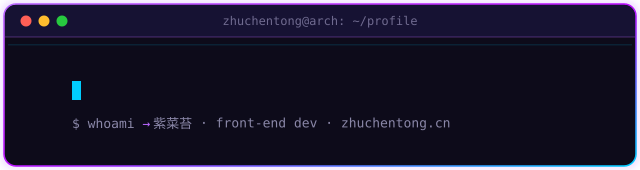

<div align="center">
  
</div>


## // ABOUT_ME

I'm **紫菜苔 (zhuchentong)**, a front-end developer from China. I build web apps with **TypeScript / Vue / Astro**, and I'm currently exploring **Rust**, **AI/ML** and game dev with **Godot**.

- 📖 I write about front-end & tech on my blog: [zhuchentong.cn](https://zhuchentong.cn)
- 🌱 Currently learning **Rust**, **AI/ML** and **MoonBit**
- 🤝 Open to collaborating on open-source & creative projects


## // TECH_STACK

<div align="center">
  <br/>
  
</div>


## // STATS

<div align="center">
  
  
  <br/>
  
  <br/>
  
</div>


## // WAKATIME

<!--START_SECTION:waka-->
📊 **This Week I Spent My Time On** 

```text
🕑︎ Time Zone: Asia/Shanghai

💬 Programming Languages: 
No Activity Tracked This Week

🐱‍💻 Projects: 
No Activity Tracked This Week

💻 Operating System: 
No Activity Tracked This Week
```

🤖 **AI Coding This Week** 

```text
No AI Coding Activity Tracked This Week
```


 Last Updated on 16/10/2026 03:11:06 UTC
<!--END_SECTION:waka-->


## // SNAKE

<div align="center">
  <picture>
    <source media="(prefers-color-scheme: dark)" srcset="https://raw.githubusercontent.com/zhuchentong/zhuchentong/output/github-contribution-grid-snake-dark.svg" />
    <source media="(prefers-color-scheme: light)" srcset="https://raw.githubusercontent.com/zhuchentong/zhuchentong/output/github-contribution-grid-snake.svg" />
    
  </picture>
</div>


## // CONNECT

[](https://zhuchentong.cn)

<!-- External services this page depends on (verify URLs after any change):
     - capsule-render.vercel.app        header image
     - ./assets/cyber-terminal.svg      self-drawn terminal typing animation (SMIL, no external dependency)
     - ./assets/neon-divider.svg        self-drawn neon divider (SMIL-free, static)
     - skillicons.dev                   skill icon wall
     - github-readme-stats.vercel.app   stats / top-langs / trophy cards
     - streak-stats.demolab.com         streak stats card
     - wakatime.com (via anmol098/waka-readme-stats Action)  weekly coding + AI coding
                                        stats between START/END_SECTION:waka markers
                                        (.github/workflows/wakatime.yml; needs
                                        WAKATIME_API_KEY + GH_TOKEN secrets)
     - Platane/snk via GitHub Actions   snake SVGs on `output` branch (.github/workflows/snake.yml)
     Note: *.vercel.app is unreachable from some networks (e.g. CN) directly; images are fetched and cached by GitHub (camo proxy), so visitors usually see them fine. Final visual check must be done on github.com after push.
-->
